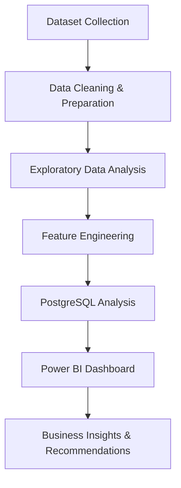

# 📊 CloudSync CRM | SaaS Customer Churn Analysis

Analyzing SaaS customer churn, retention patterns, and revenue risks to identify key churn drivers and support data-driven customer retention strategies.

<p align="left">
  
  
  
</p>

---

## 📑 Table of Contents

1. [Project Overview](#-project-overview)
2. [Business Problem](#-business-problem)
3. [Business Questions](#-business-questions)
4. [Dataset Description](#-dataset-description)
5. [Tools & Technologies](#-tools--technologies)
6. [Project Workflow](#-project-workflow)
7. [Data Cleaning & Validation](#-data-cleaning--validation)
8. [Analysis](#-analysis)
9. [Dashboard / Visualization](#-dashboard--visualization)
10. [Key Insights](#-key-insights)
11. [Business Recommendations](#-business-recommendations)
12. [Project Report](#-project-report)
13. [Conclusion](#-conclusion)
14. [Repository Structure](#-repository-structure)

---

## 📌 Project Overview

This project focuses on analyzing customer churn for **CloudSync CRM**, a fictional Software-as-a-Service (SaaS) company. The analysis examines customer demographics, subscription behavior, engagement levels, support experience, revenue contribution, and churn patterns.

Using Python for data preparation and exploratory analysis, PostgreSQL for business-focused SQL analysis, and Power BI for interactive visualization, the project aims to identify the factors associated with customer churn and highlight customers who may require proactive retention efforts.

## 🎯 Business Problem

CloudSync CRM is experiencing customer churn, resulting in recurring revenue loss and increased customer acquisition costs. The business needs to understand which customer segments are more likely to leave, what factors influence their decisions, and which high-value customers are at risk.

## ❓ Business Questions

- Which subscription plans and customer segments experience the highest churn?
- How do customer engagement levels and product usage relate to churn?
- Does customer support experience influence customer retention?
- How do industry, billing frequency, and auto-renewal behavior relate to churn?
- Which high-revenue customers should be prioritized for retention?
- What are the most frequently reported reasons for customer churn?

## 📂 Dataset Description

**Source:** Synthetic SaaS Customer Dataset

The dataset contains customer-level information for a fictional SaaS business, covering customer demographics, subscription details, engagement, revenue, support experience, and churn-related attributes.

- **Records:** 9,000 customers
- **Features:** 30+ attributes
- **Structure:** Customer-level dataset containing demographic, subscription, engagement, revenue, and churn information.
- **Data Type:** Synthetic data
- **Explore File:** [Data](data/)

## 🛠️ Tools & Technologies

| Tool | Purpose |
|---|---|
| Python (Pandas, NumPy) | Data cleaning, transformation, feature engineering, and exploratory data analysis |
| Matplotlib & Seaborn | Exploratory data visualization |
| PostgreSQL | SQL-based business analysis and customer segmentation |
| Power BI | Interactive dashboard development and business insights |

## 🔄 Project Workflow



## 🧹 Data Cleaning & Validation

The dataset was prepared using Python to improve data quality and ensure consistency before analysis.

Key activities included:

- Identifying and removing duplicate records.
- Handling missing values.
- Standardizing text formatting and correcting inconsistent values.
- Validating data types and data consistency.
- Creating business-focused features for customer analysis.

📄 **Detailed documentation:** [Explore the Python Analysis Notebook](Python%20code.ipynb)

## 🗄️ Analysis (EDA & SQL)

The analysis combines exploratory data analysis in Python with business-focused SQL queries in PostgreSQL.

**Python EDA and Feature Engineering:**
- Customer demographics and churn distribution.
- Subscription and billing behavior.
- Customer engagement and support experience.
- Revenue-based customer segmentation.
- Customer lifecycle and retention priority classification.

**PostgreSQL Business Analysis:**
- Customer churn analysis.
- Customer engagement analysis.
- Customer satisfaction analysis.
- Revenue analysis.
- Customer retention analysis.

📁 **Explore the complete SQL analysis:** [SQL Files](sql/)

📓 **Explore Python analysis:** [Python Code Notebook](Python%20code.ipynb)

## 📊 Dashboard / Visualization

An interactive Power BI dashboard was developed to present customer churn patterns, subscription behavior, customer engagement, revenue contribution, and retention-related findings.

📊 **Explore dashboard files:** [Power BI Dashboard Folder](dasboard/)

## 💡 Key Insights

- **Subscription Plans:** Standard and Basic plans account for the highest number of churned customers.
- **Customer Engagement:** Customers with lower engagement and product usage show greater churn tendencies.
- **Support Experience:** Poor customer support experience is associated with higher customer churn.
- **Billing & Renewal:** Monthly billing customers show greater churn tendencies, while auto-renewal customers demonstrate stronger retention.
- **Industry Analysis:** Churn patterns vary across industries, with IT and Finance showing higher churn.
- **Revenue Risk:** Some high-revenue customers were classified as **Immediate Outreach**, indicating potential revenue exposure.
- **Churn Reasons:** Low product usage is the most frequently reported reason for churn.

## 🚀 Business Recommendations

- **Improve Retention for High-Churn Plans:** Introduce targeted retention campaigns, personalized offers, and renewal incentives for Standard and Basic plan customers.
- **Increase Customer Engagement:** Use onboarding programs, in-app guidance, and product education to encourage regular product usage.
- **Strengthen Customer Support:** Improve response times and first-contact resolution to address customer dissatisfaction.
- **Develop Industry-Specific Strategies:** Customize onboarding, support, and product offerings for industries experiencing higher churn.
- **Protect High-Value Customers:** Prioritize customers classified as Immediate Outreach through proactive account management and renewal follow-ups.
- **Address Low Product Usage:** Identify inactive customers early and introduce engagement campaigns before they decide to leave.


## 🏁 Conclusion

This project demonstrates an end-to-end customer churn analysis workflow using Python, PostgreSQL, and Power BI. By examining customer behavior, subscription patterns, engagement, support experience, and revenue contribution, the analysis identifies important factors associated with churn and highlights customers requiring retention attention.


## 📁 Repository Structure

## 📁 Repository Structure

```text
saas_customer_churn_analysis/
│
├── data/
│   ├── saas_customer_churn_raw.csv
│   └── saas_customer_churn_cleaned.csv
│
├── sql/
│   └── saas_customer_churn_sql_queries
│
├── dasboard/
│   └── SaaS_customer_churn_dashboard
│
├── Python code.ipynb
│
└── README.md
```


**👩‍💻 Author:** Riya Gupta

**🔗 GitHub:** [riyagupta557](https://github.com/riyagupta557)

**💼 LinkedIn:** Add your LinkedIn profile link here.

